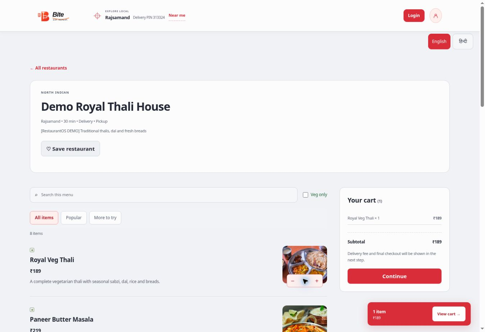

# Bite production code deployment — 10 November 2026 (Asia/Kolkata)

The user approved the concrete PR #7 website, migration and Edge release. Code deployment is complete; this is not a claim of controlled-market launch readiness.

- [PR #7](https://github.com/gauravjoshi2999/restaurant-os/pull/7) merged as `95ea6f0198da4a2b8b63f3074cb0a7c0084abac4`. Current main also preserves the newer Android update and email-only password-recovery work. The later Partner/Admin deployment-refresh work was also retained.
- Final combined PR head `6682b663de341def5c72b5ff0e0fbb979b511c57`: [QA success](https://github.com/gauravjoshi2999/restaurant-os/actions/runs/42774864958). Main merge [QA success](https://github.com/gauravjoshi2999/restaurant-os/actions/runs/42775107273). Latest inspected main [QA success](https://github.com/gauravjoshi2999/restaurant-os/actions/runs/42775742591).
- Deployment audit found that [run 42775875063](https://github.com/gauravjoshi2999/restaurant-os/actions/runs/42775875063) had workflow head d00c2d9 but actually checked out daeeae9 (its triggering QA head), overwriting a newer build. The version JSON was absent. [PR #8](https://github.com/gauravjoshi2999/restaurant-os/pull/8) fixes automatic stale-run admission, scopes concurrency to eligible jobs, and rechecks main immediately before publication. PR QA [42776591178](https://github.com/gauravjoshi2999/restaurant-os/actions/runs/42776591178) passed; the fix merged as `97c1793bc84c80099c54330f26683eea948f781e`. Android manifest/checker remain in public packaging.
- Final [main QA 42776689463](https://github.com/gauravjoshi2999/restaurant-os/actions/runs/42776689463) and [Pages deployment 42776780812](https://github.com/gauravjoshi2999/restaurant-os/actions/runs/42776780812) both succeeded for `97c1793bc84c80099c54330f26683eea948f781e`. Deployment logs confirm that exact checkout/BITE_DEPLOY_SHA. Live `bite-deploy-version.json` returned HTTP 200 with that SHA; the Owner/Admin HTML meta stamp matched and its placeholder was replaced. This distinguishes the actual published code from the workflow's default-branch head.
- All five new/replaced function endpoints rejected unauthenticated POST requests with HTTP 401. This confirms the public authentication boundary, not a signed-in acceptance pass.
- Supabase migration `bite_launch_completion` applied successfully as actual hosted version `20261110072018`. The source migration filename remains `20261109201541_bite_launch_completion.sql`; do not replay it under a second name/version.
- Five Edge functions ACTIVE: `bite-live-create-session` v7, `bite-live-verify-checkout` v6, `bite-cashfree-operations` v1, `bite-assets` v5, `bite-order-maintenance` v1. JWT verification stays enabled for the four user/Admin functions; the maintenance endpoint uses its own secret and rollout checks. Final assets source matches the reviewed file.
- Storage API provisioning created public raster-only `bite-menu` (5 MiB) and private photo/PDF `bite-private` (8 MiB). Provisioning used a deployment-time server initializer without exposing service credentials; the original Admin-protected function source was restored afterward. Configured buckets are not proof of a successful authenticated upload/download acceptance test.
- Read-only production checks: ten new tables have RLS; anonymous PIN storefront works (five listed restaurants/six categories); private Admin/customer APIs and the service finalizer are denied to anon. Timeout is disabled; zero refund jobs and zero published QA parents/test coupons. No real refund, payout, bank edit, Auth account change or customer charge performed.

## Verification and limits

62 Node behavior checks, 46 public browser smoke checks and 23 synthetic Customer/Owner/Admin browser checks passed in the reviewed QA suite; 22 isolated PostgreSQL checks passed earlier. Fresh live browser smoke verified PIN 313324, the Demo Royal Thali House menu (eight items), Royal Veg Thali cart subtotal ₹189, the favourites control and protected Owner/Admin login entry. The fresh 22-case live rollback probe required native confirmation that expired; it is not counted as a production pass and left no test records.

Market launch remains NO-GO until actual signed-in Customer–Owner–Admin/payment acceptance, email recovery delivery, authenticated Storage acceptance, approved business/legal and marketplace payout readiness, and backup restoration/load evidence are complete. A rollback schema/function checkpoint was captured before deployment; this is not a certified full database backup or restore drill. Existing intentional SECURITY DEFINER RPC advisor notices and leaked-password-protection warning remain documented, not silently declared resolved.

