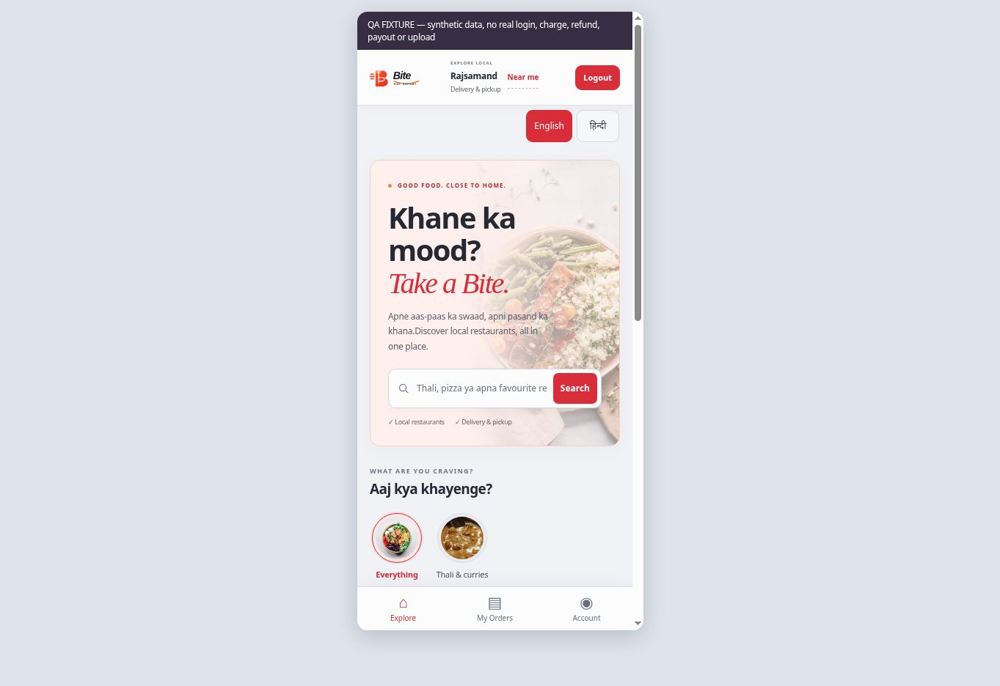
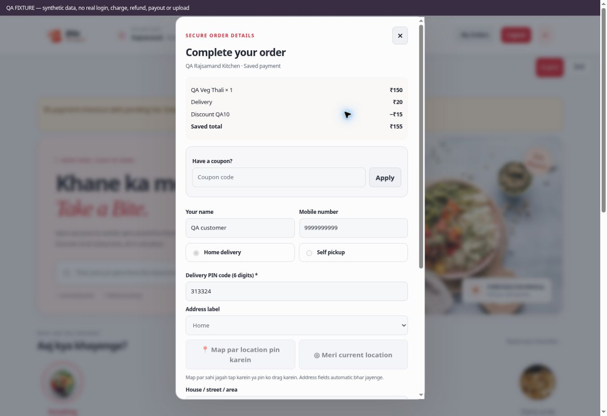

# Release evidence — 10 November 2026 (Asia/Kolkata)

Status: source prepared for review, not deployed. Market launch remains NO-GO until the gates in README and OWNER_INPUTS are met. Base main: `811122e312fcb27cc72f87130a70926c1755cf13`.

| Layer | Result | Practical limit |
| --- | --- | --- |
| Node behavior suites | 62/62 pass, zero skipped | Mocked provider/network responses; no real charge, refund or payout |
| Frontend/Owner structure checks | Pass | Parsing, wiring and guard checks do not replace signed-in acceptance |
| All external asset JavaScript | Node syntax pass | Not a complete browser execution proof |
| Workflow YAML / public package | Parse/build pass | Only runtime files packaged; QA fixtures/SQL/docs excluded |
| Expanded database probe | 22/22 pass in isolated PGlite 0.4.0 PostgreSQL | Current schema metadata plus wholly synthetic records; not hosted Auth/Storage acceptance |
| Earlier live rollback probe | 16 groups passed on an earlier revision | Final expanded native confirmation expired; no expanded live pass claimed |
| Browser, public baseline | Restaurants/menu/cart inspected | Existing backend; new PIN RPC not deployed |
| Browser, synthetic UI | Customer/Owner/Admin interactions inspected; PDF downloaded/rendered | Explicit QA transport; no real accounts, payment, upload or bank lookup |
| Final mobile/recovery recheck | 390px preview inspected; pending checkout restores ₹155 and locks original contact/address | Synthetic fixture; screenshots below |
| Fresh email/reset/provider/Storage/scheduler/bank acceptance | Not performed | Needs approved configuration, controlled accounts and separate financial authorization |

`local-database-evidence.json` contains case names, catalog hashes and rollback proof: staged schema absent, QA parent private, zero remaining test orders. It contains no customer contact or payment credential. Production was not migrated or redeployed during these changes. The old ₹174 order was inspected read-only in the database; actual provider settlement or restaurant bank credit was not established.

## CI

[Bite QA run 42745733431](https://github.com/gauravjoshi2999/restaurant-os/actions/runs/42745733431) completed **successfully**. Head: `4107552a55adf4a9cb780419f5f835b242b6876c`; PR merge checkout: `65647310a1885e6f4817f2bce6dfc6bd4b473116` (same runtime source). Job `static-qa` / `129597249792`: source/61 Node checks, public packaging, Chromium public smoke and synthetic UI all passed.

- Public browser smoke: **46 checks**, including public restaurant/menu/cart, guarded login/readiness, account/address layout at 1365/390/340px and protected Owner/Admin sign-in. Read-only real public data; no signed-in customer order/payment acceptance.
- Synthetic Customer/Owner/Admin browser suite: **23 checks**, including PIN/pickup, favourite, downloaded PDF, reorder/coupon, profile/language, Owner offer create/pause, rejected SVG, Admin directory/categories/finance, scheduler guard and pending snapshot recovery. No uncaught JS error.
- [Screenshots, PDF and browser evidence artifact](https://github.com/gauravjoshi2999/restaurant-os/actions/runs/42745733431/artifacts/13730429311): `bite-ui-qa-65647310a1885e6f4817f2bce6dfc6bd4b473116`, 314687 bytes, SHA-256 `1d321c7ce18240d360fa872fe2c1fae6c1e390089cb03b7cebc5e3873638af89`.

[Review PR #7](https://github.com/gauravjoshi2999/restaurant-os/pull/7). A final recovery display regression also restores pickup/delivery, note and address label from the saved checkout instead of a stale form selection. The PR checks must finish successfully for that final head before approval/merge. No main merge or deployment was performed.
